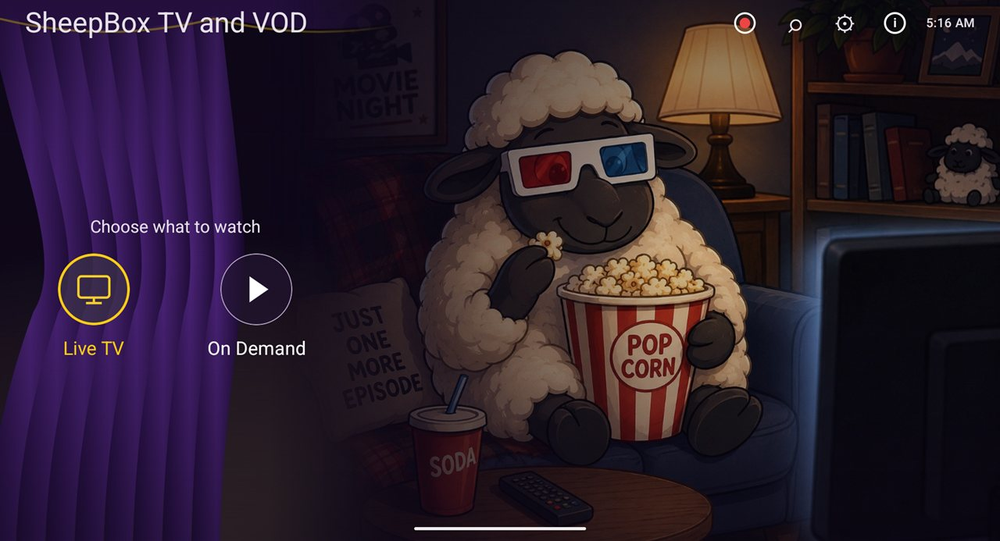
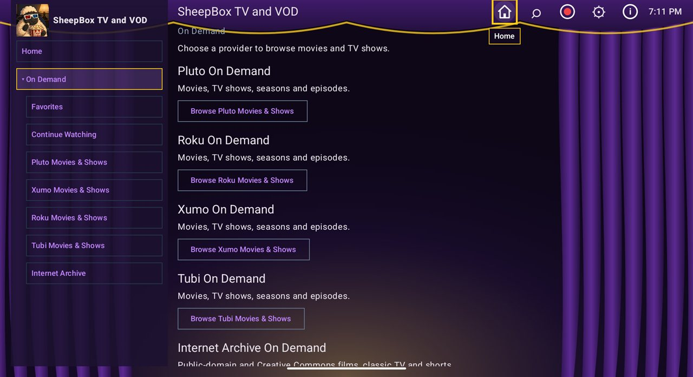

# SheepBox TV and VOD

**Free live TV and free movies & shows. One app, one remote.**

  
  

---

## ✨ Features

| | Feature | What you get |
|:-:|---|---|
| 📺 | **Live TV** | IPTV-org channels by country and genre, plus Pluto TV, Samsung TV Plus, Plex, Roku, Tubi and Xumo line-ups |
| 🗓️ | **TV guide** | A 6-hour program grid with Now / Next, built from public guide sources |
| 🎬 | **On Demand** | Free movies and shows from Pluto TV, Roku, Xumo, Tubi and the Internet Archive |
| 📚 | **Every season & episode** | One show screen with the description, all seasons and all episodes, for every provider |
| 🏛️ | **24/7 channels** | Always-on classic TV and cartoon channels from the Internet Archive |
| 🔎 | **Search everything** | One search across all channels and titles, plus search inside each provider |
| ⭐ | **Favorites & Continue Watching** | Hold OK to favorite; pick up where you left off; auto-play next episode |
| 🎮 | **Made for the remote** | One clear yellow focus border, labelled icons, ±15 s skip with hold-to-seek |
| 🔄 | **Automatic updates** | Checks for new versions at startup and installs them with your OK |

---

## 📥 How to Install

**Step 1 — Allow installs**
> On the TV box, open **Settings › Device Preferences › Security & restrictions** (names vary) and allow
> installing apps from unknown sources for the app you'll use to install SheepBox (for example Downloader
> or a file manager).

**Step 2 — Get the APK**
> Open **[Releases](https://github.com/sheepman90s/sheepbox-releases/releases)**, pick the newest version
> and download the `.apk` file. On the TV you can use the free **Downloader** app and enter this page's
> address; or download on a phone/PC and send the file to the TV.

**Step 3 — Install**
> Open the downloaded `.apk` and choose **Install**. If Google Play Protect asks to scan, you can choose
> **Install without scanning**.

**Step 4 — First start**
> SheepBox checks your network and for updates, then loads the channels. The first time you open each
> On Demand provider it builds a local catalog (with a progress bar); after that it opens instantly.

---

## 🔄 Updates

| | |
|:-:|---|
| 🚀 | When a new version is published here, SheepBox shows **Update available** at startup with what's new |
| 🛡️ | Each download is checked (same app, newer version, same signing key) before Android's installer opens |
| ⚙️ | **Settings › App updates**: startup check on/off, include test versions, **Check for updates now** |
| 🆕 | After updating, a **What's new** pop-up lists the changes |

Signing certificate SHA-256: `a8ee97fd44e560a1b2921ce87e73a9e76b22a336de1bfc0f5723d846b693acff`

---

## 🔗 Links

| | |
|:-:|---|
| 📦 | [All releases & downloads](https://github.com/sheepman90s/sheepbox-releases/releases) |
| 📝 | Release notes: open any release on the [Releases](https://github.com/sheepman90s/sheepbox-releases/releases) page |

---

SheepBox is an independent project and is not affiliated with Pluto TV, Roku, Xumo, Tubi, Samsung, Plex,
IPTV-org or the Internet Archive. It plays only content those services offer for free; availability varies
by region.

© 2026 [sheepman90s](https://github.com/sheepman90s)

