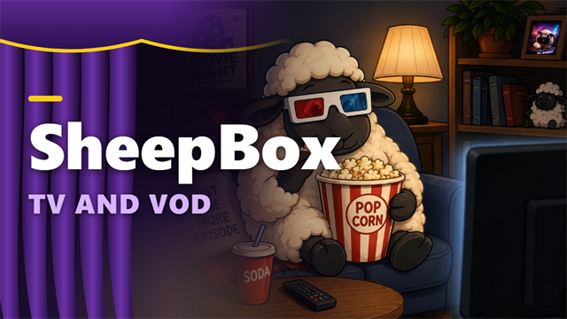

# SheepBox TV and VOD

**Free live TV and free movies & shows. One app, one remote.**

[Website](https://sheepman90s.github.io/sheepbox-releases/) · [Downloads](https://github.com/sheepman90s/sheepbox-releases/releases) · [Supported providers](PROVIDERS.md) · [Roadmap](ROADMAP.md)

**Current stable release: [1.2.0](https://github.com/sheepman90s/sheepbox-releases/releases/tag/v1.2.0), version code 139.** Promotes the tested RC8 functionality to the regular update channel, including resumable initial-load batches for large FilmRise categories. Three provider-limited categories retain + counts. Update in **Settings > App updates > Check now > Update now**; test versions do not need to be enabled.

**Latest test release: [1.3.0 - RC3](https://github.com/sheepman90s/sheepbox-releases/releases/tag/v1.3.0-RC3), code 142.** Fixes Web Cams with country-first browsing and local category counts, adds a native World View globe as the fifth Home choice, and appends confidently matched backup streams to existing channels. Camera search, favorites and YouTube playback stay inside SheepBox. Enable **Settings > App updates > Include test versions > Check now > Update now** to try it. Stable 1.2.0 remains the regular release.

  
  

Screenshots show **1.1.0 - RC4**; the provider list below reflects **1.2.0**.

## Features

| Feature | What you get |
|---|---|
| Live TV | Live TV Simple's channel-logo grid with My Stations, News, Local, Entertainment and Sports; Live TV Complete with provider, country and genre menus |
| TV guide | A six-hour program grid, provider schedules where available, Now / Next and optional international guide sources |
| On Demand | Movies and shows from Pluto TV, Roku, Xumo, Tubi, Sling Freestream, Fawesome, Local Now, STIRR, FilmRise and the Internet Archive |
| Consistent browsing | Shared cards, Play/Episodes and Favorite actions, unique title counts beside categories (+ means incomplete), search, A–Z ordering and first-open catalog progress |
| Seasons & episodes | Shared show screen with descriptions, seasons, episodes and optional autoplay |
| Recording & DVR | Record supported live streams now or schedule from the guide; manage recordings on the box or a USB drive. Protected streams and unsupported ad-managed sources cannot be recorded |
| Archive 24/7 | Always-on collection channels assembled from public-domain / Creative Commons films and classic TV |
| Search & favorites | Global and provider search, favorites, Continue Watching and resume |
| TV remote controls | Clear yellow focus, labelled icons, 15-second skip and hold-to-seek |
| Automatic updates | Startup checks, optional test versions, verified downloads and Android installation confirmation |

VOD catalogs load when opened and use local metadata caches. Reload refreshes them; providers and regions can change what is available. FilmRise uses bounded initial-load batches and alternate sort orders to retrieve more titles, deduplicates stable IDs, and resumes interrupted loads from completed batches. True Crime now has all 251 movie titles. Some largest guest categories remain incomplete and show lower-bound + counts; Reload can retry. FilmRise service checks passed for catalog discovery, movie/episode primary HLS manifests and ad schedules; physical-TV picture, audio, captions, remote navigation and complete ad breaks still need device testing.

## Providers

**Live TV:** IPTV-org, Pluto TV, Samsung TV Plus, LG Channels, Plex, Roku Channel, Tubi, Xumo, Sling Freestream, YuppTV Free, Fawesome, Local Now and STIRR.

**On Demand:** Pluto TV, Roku Channel, Xumo, Tubi, Sling Freestream, Fawesome, Local Now, STIRR, FilmRise and the Internet Archive.

FilmRise is **VOD-only**. Plex VOD is not implemented. Internet Archive also supplies SheepBox-created 24/7 collection channels. See the [full provider matrix and limitations](PROVIDERS.md).

## Roadmap

- **Closed Captioning:** consistent controls, track/language selection and saved preferences where supported.
- **Split Screen:** multiple supported streams, remote-friendly pane selection and audio controls.
- **Additional Providers:** continued research and integrations for free, account-free Live TV and VOD.

These are planned features, without committed dates. See [ROADMAP.md](ROADMAP.md) for scope and the provider research queue.

## Install and update

1. Allow installs from your chosen downloader or file manager in the TV's Android settings.
2. Download the APK from [1.2.0](https://github.com/sheepman90s/sheepbox-releases/releases/tag/v1.2.0), or browse [all releases](https://github.com/sheepman90s/sheepbox-releases/releases).
3. Open the APK and follow Android's installation prompts.
4. Start SheepBox. It checks the connection and loads live channels; each On Demand catalog builds when first opened.

For in-app updates: **Settings > App updates > Check now > Update now**. Test versions are optional. Downloads are checked for the same package, a newer version and the established signing key before Android's installer opens. Keep the existing app installed to retain settings and favorites.

Signing certificate SHA-256: `a8ee97fd44e560a1b2921ce87e73a9e76b22a336de1bfc0f5723d846b693acff`

## Free streams and availability

SheepBox plays providers' free, ad-supported streams, IPTV-org free-to-air channel lists, and public-domain / Creative Commons collections from the Internet Archive. It hosts no streaming service, does not bypass subscriptions or DRM, and retains provider advertising. Recordings of supported streams can be stored locally.

SheepBox is independent and is not affiliated with these providers. Availability varies by region and device; unofficial integrations can change. Report problems through [GitHub issues](https://github.com/sheepman90s/sheepbox-releases/issues).

© 2026 [sheepman90s](https://github.com/sheepman90s)

Roku on-demand in RC3 also uses Roku's new canonical API hostname, fixing playback requests that previously redirected to an HTML response instead of JSON.
