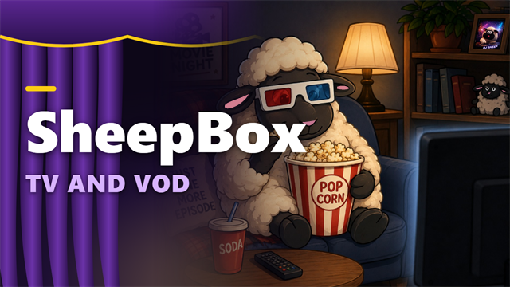
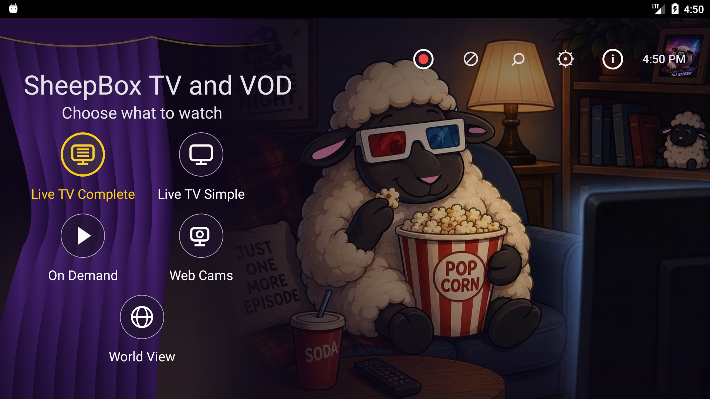
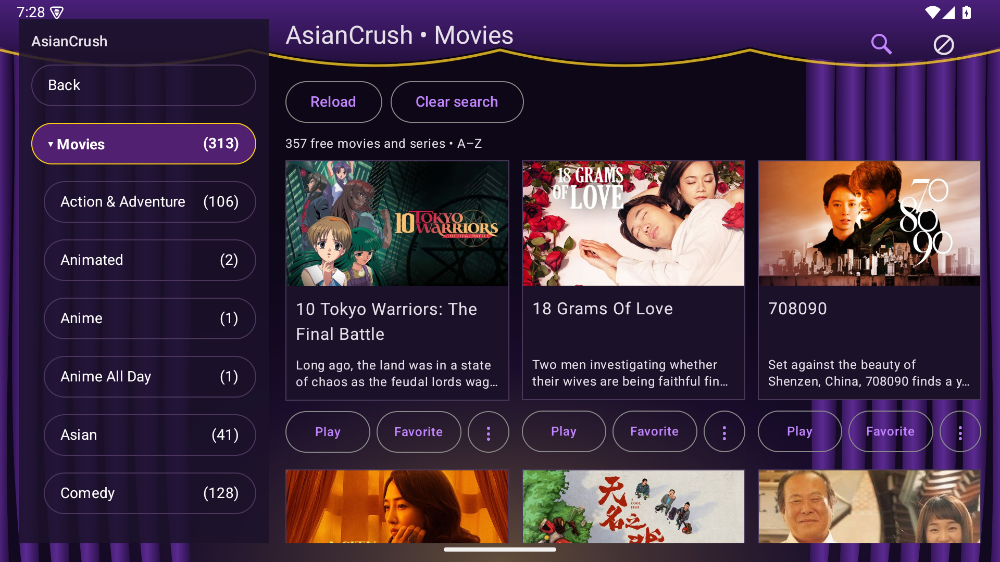

# SheepBox TV and VOD

**Free live TV, movies and shows. One app, one remote.**

[Website](https://sheepman90s.github.io/sheepbox-releases/) · [Web preview](https://sheepman90s.github.io/sheepbox-releases/watch/) · [Providers](PROVIDERS.md) · [Roadmap](ROADMAP.md) · [Report a problem](https://github.com/sheepman90s/sheepbox-releases/issues/new?template=bug_report.yml) · [Request a feature](https://github.com/sheepman90s/sheepbox-releases/issues/new?template=feature_request.yml)

SheepBox brings free streaming services together in an Android TV and Google TV app with shared browsing, search, favorites and remote controls.

## Download

| Version | Download | Details |
|---|---|---|
| **2.0.0 stable** | [Sheepbox-latest.apk](https://github.com/sheepman90s/sheepbox-releases/releases/latest/download/Sheepbox-latest.apk) | Recommended for regular use. [Release notes](https://github.com/sheepman90s/sheepbox-releases/releases/tag/v2.0.0) |

[Versioned 2.0.0 APK](https://github.com/sheepman90s/sheepbox-releases/releases/download/v2.0.0/sheepbox-tv-vod-2.0.0-release.apk) / [SHA256](https://github.com/sheepman90s/sheepbox-releases/releases/download/v2.0.0/sheepbox-tv-vod-2.0.0-release.apk.sha256) / [Previous releases](https://github.com/sheepman90s/sheepbox-releases/releases).

**2.0.0 / Android build215** promotes the tested RC12 feature set to stable. Install over 1.9.0 or an existing 2.0 release candidate to retain personal data. Test-version opt-in is not required.

Requires Android 6.0 or later. Install updates over the existing app to retain settings, favorites and history.

## Install and update

1. Download the [stable APK](https://github.com/sheepman90s/sheepbox-releases/releases/latest/download/Sheepbox-latest.apk) to your TV or streaming device.
2. In Android settings, allow your chosen downloader or file manager to install apps.
3. Open the APK and follow Android's installation prompts.
4. Start SheepBox. On Demand catalogues load when first opened and use saved metadata caches on later visits.

For updates, open **Settings > App updates > Check now > Update now**. Stable 2.0.0 is offered without enabling test versions; that setting is only for future prereleases. Downloads are checked for the expected package, a newer version and the established signing key before Android's installer opens.

Signing certificate SHA-256: `a8ee97fd44e560a1b2921ce87e73a9e76b22a336de1bfc0f5723d846b693acff`

## Features

- Live TV Simple and Live TV Complete, with provider, country and genre browsing.
- Programme guide, search, favorites, Continue Watching and supported playback resume.
- On Demand categories, title artwork, seasons and episodes, with provider-specific caching.
- Web Cams and World View for country-based browsing.
- Recording and scheduled DVR for supported streams, with local or USB storage.
- Personal backups, hidden items, private in-app problem reports and optional device optimization.
- TV remote navigation and captions where the provider and player support them.
- 2.0 stable: World View explains `Channel Up/Down: zoom in/out` before and during globe selection; mark movies, series and episodes watched/unwatched; play CDNLive in the native player and browse Samsung's worldwide lineup. New guide presets enable automatically when a slot is free, with later opt-outs remembered. Includes 30 guide sources and recording keyword searches as listings arrive. LG regional sources may be unavailable; existing US channels are retained.
- Watch-party chat uses a smaller panel beside the video, restoring the previous video size and focus when closed. Native support remains BYUtv, NASA+ and NFB on demand.
- Includes cache cleanup, provider status and the earlier 2.0 fixes.

  
  

Screenshots are from the 1.9.0 release-candidate series. See [supported providers and limitations](PROVIDERS.md) for current Android and browser coverage.

## Web preview

[Open SheepBox Web RC2](https://sheepman90s.github.io/sheepbox-releases/watch/) in a desktop or mobile browser. It includes 21,558 top-level On Demand entries, 1,205 live listings and 3,892 webcams, plus search, favorites, history, watched/unwatched controls and browser backups. Complete audited Philo Free VOD and BYUtv metadata includes show and episode browsing. Settings has catalogue cache clearing and provider coverage; Live TV links to the CW programme guide. World View supports explicit globe selection and keyboard zoom.

Browser support differs from Android. Philo, BYUtv, Fawesome and Roku open their official players in a new tab; return to SheepBox to continue browsing. Some other sources use supported direct or embedded playback, and other provider entries are website links only. Certain libraries are selections rather than whole-service catalogues. Offline browsing uses saved metadata; watching needs a connection. Recording/DVR, watch parties and automatic Android library sync are not available on the web. See [web provider coverage](PROVIDERS.md#web-preview) for counts and limits. Region, browser and publisher restrictions apply.

## Availability and support

SheepBox is independent and is not affiliated with its listed providers. It hosts no video. Streams come from providers' free offers, free-to-air directories and public-domain or Creative Commons collections. Provider advertising, access restrictions and normal content protection remain in place.

Catalogues change, some services return incomplete results, and a **+** beside a count means the loaded catalogue is incomplete. Captions, recording, resume and autoplay depend on the source. Some streams may be unavailable or temporarily fail; retry or refresh the provider before [reporting a problem](https://github.com/sheepman90s/sheepbox-releases/issues). Include the app version, device model, provider and title, without account details or private playback links.

Provider additions are paused while we maintain and improve 2.0. See the [roadmap](ROADMAP.md) for planned work.

Use [Bug report or Feature request](https://github.com/sheepman90s/sheepbox-releases/issues/new/choose) to submit public feedback. Feature requests receive the **enhancement** label so suggestions can be tracked and discussed separately from bugs. Keep private details in the app's private reporting flow.

© 2026 [sheepman90s](https://github.com/sheepman90s)
